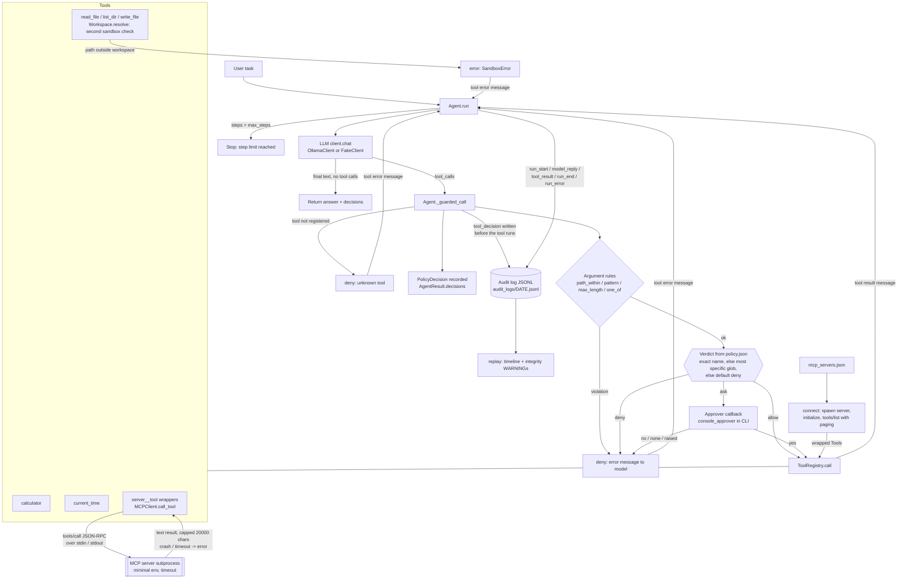

# Flow: Guarded Tool Agent

Status: **Day 5**. Solid boxes exist today, dashed boxes are planned (day in brackets).

## How it works today

1. `Agent.run(task)` starts a message list with a system prompt and the user task.
2. Each step sends the messages and the tool schemas to the LLM client.
3. If the reply has no tool calls, its text is the final answer.
4. Otherwise every tool call goes through `Agent._guarded_call`, the only place a tool can run:
   * unknown tool: recorded as `deny`, the model gets `error: unknown tool ...`;
   * argument rules from `policy.json` are checked first; any violation is a `deny` and the approver is not asked;
   * then the tool's verdict applies: `allow` runs, `deny` blocks, `ask` calls the approver (no approver, a "no", or an approver error all block).
   * Blocked calls return `error: denied by policy: <reason>` to the model so it can explain instead of crashing.
5. Each call leaves a `PolicyDecision` (tool, arguments, verdict, reason, approved) in `AgentResult.decisions`.
6. After `max_steps` model turns the run stops with `stopped_reason = "max_steps"`.

7. File tools (`files.py`) work inside one workspace folder. A path is checked twice: by the `path_within` rule in `policy.json` (denied before the tool or a human sees it) and again by `Workspace.resolve` inside the tool, so even `Policy.allow_all()` cannot read or write outside the workspace. Shipped verdicts: `read_file` and `list_dir` allow, `write_file` ask.

8. With an `AuditLog`, every step is appended to a JSONL file: `run_start` (task, model, tools, policy default), `model_reply` per step, `tool_decision` for each call (written before the tool runs), `tool_result`, and `run_end` or `run_error`. Events share a `run_id` and carry a `seq`. Strings over 2000 chars are clipped in the log only. `python -m guarded_agent replay <log> [run_id]` prints the timeline and warns about gaps, unfinished runs or results without a verdict.

9. MCP servers listed in `mcp_servers.json` (CLI: `GUARDED_AGENT_MCP=mcp_servers.json`) are started as subprocesses by `connect()`. The client does the `initialize` handshake, pages through `tools/list` and wraps each tool as `<server>__<tool>`. Those wrappers sit in the same `ToolRegistry`, so they pass through `_guarded_call` like any other tool: a denied call is never sent to the server. Policy keys can be glob patterns (`demo__*`); an exact name wins over a pattern, and the most specific pattern wins over a broader one. Servers get a minimal environment, their output is capped, and a crash or timeout comes back to the model as an `error:` tool message.

`Policy.from_file("policy.json")` loads the policy. Unlisted tools use `default` (shipped as `deny`), and relative `path_within` roots resolve against the policy file's folder.
