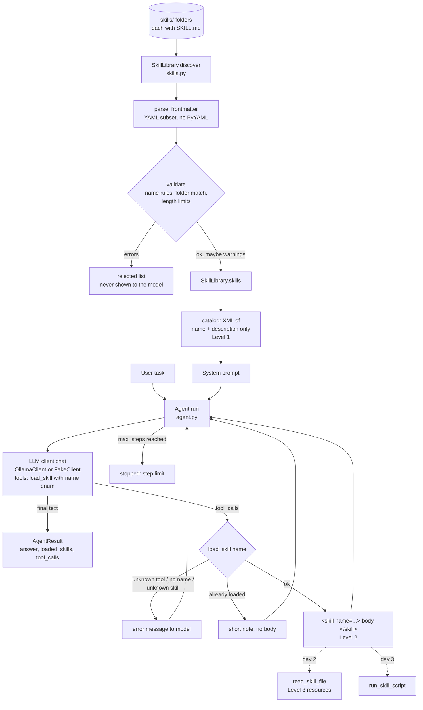

# Flow: Skills Agent

Status: **Day 1**. Every box exists in the code. Dashed boxes are planned for later days.

## How it works

1. **Discovery.** Every subfolder of `skills/` with a `SKILL.md` is parsed. The frontmatter must have a valid `name` (lowercase, digits, single hyphens, at most 64 chars, equal to the folder name) and a `description` (at most 1024 chars). Broken skills go to `rejected` with a reason and never reach the model.
2. **Level 1.** The system prompt contains only the catalog: each skill's name and description in XML. No instructions.
3. **Level 2.** The model has one tool, `load_skill`. Its `name` parameter is an enum of valid names. The tool returns the skill's Markdown body wrapped in `<skill name="...">`. Loading the same skill again returns a short note instead.
4. **Answer.** The loop ends when the model replies without tool calls, or after `max_steps` (default 6).
5. **Errors** (unknown skill, missing name, unknown tool) go back to the model as tool messages starting with `error:`, so it can recover.
