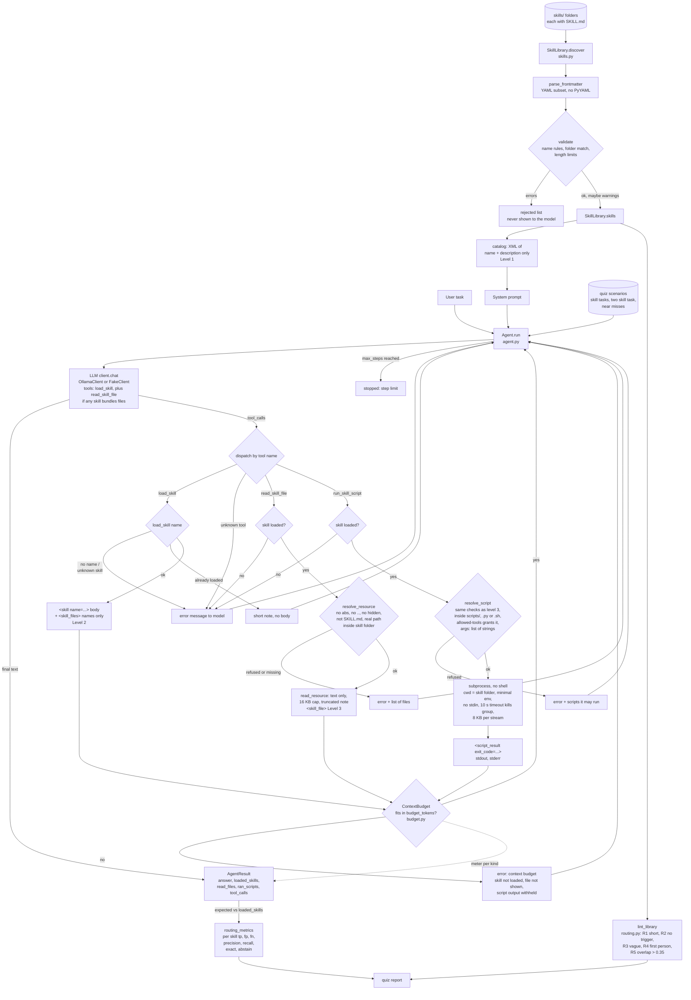

# Flow: Skills Agent

Status: **Day 5**. Every box exists in the code. The dashed arrow is the per kind meter that ends up in `AgentResult.context`. The bottom part is the routing eval, which runs outside the agent loop.

## How it works

1. **Discovery.** Every subfolder of `skills/` with a `SKILL.md` is parsed. The frontmatter must have a valid `name` (lowercase, digits, single hyphens, at most 64 chars, equal to the folder name) and a `description` (at most 1024 chars). Broken skills go to `rejected` with a reason and never reach the model.
2. **Level 1.** The system prompt contains only the catalog: each skill's name and description in XML. No instructions.
3. **Level 2.** The model has the `load_skill` tool. Its `name` parameter is an enum of valid names. The tool returns the skill's Markdown body wrapped in `<skill name="...">`, followed by a `<skill_files>` list of the other files in the folder (names only). Loading the same skill again returns a short note instead.
4. **Level 3.** If any skill bundles files, the model also gets `read_skill_file(skill, path)`. It only works after that skill was loaded. The path must be relative, without `..` or hidden parts, not `SKILL.md`, and its real location (symlinks followed) must be inside the skill folder. At most 16 KB of UTF-8 text comes back in `<skill_file>`; longer files are cut with a `[truncated]` note. Every successful read is recorded in `AgentResult.read_files`.
5. **Scripts.** If a skill's frontmatter says `allowed-tools: run_skill_script` (or `run_skill_script(scripts/x.py)` for one script), the model also gets `run_skill_script(skill, script, args)`. It only works after `load_skill`. The script must be a `.py` or `.sh` file in the skill's `scripts/` folder, pass the same path checks as level 3, and be granted by `allowed-tools`. It runs with no shell (args are a list of strings), the skill folder as working directory, no stdin, a minimal environment and a 10 second timeout that kills the whole process group. Up to 8 KB of stdout and stderr come back in `<script_result exit_code=...>`. Every run is recorded in `AgentResult.ran_scripts`.
6. **Context budget.** Every run has a `ContextBudget` (`budget.py`). It charges the system prompt, task and tool schemas, then every tool result, estimating tokens as characters / 4. With `budget_tokens` set, a skill body, file or script output that would push the run past the limit is replaced by `error: context budget ...`; a refused skill is not marked loaded. The per kind totals end up in `AgentResult.context`. `python3 -m skills_agent.budget` prints the cost of each level and compares it with pasting every skill into the prompt.
7. **Routing eval.** `routing.py` lints every description (too short, no "Use when" clause, vague words, first person, or too similar to another skill) because the description is all the model sees at level 1. `quiz/quiz_model.py` runs skill tasks, a two skill task and near misses (tasks that share words with a description but need no skill), then compares each run's `loaded_skills` with the expected set and prints per skill precision and recall, exact routing and how many no-skill runs stayed without a skill. `python3 -m skills_agent.routing` prints the lint report alone.
8. **Answer.** The loop ends when the model replies without tool calls, or after `max_steps` (default 6).
9. **Errors** (unknown skill, missing argument, unknown tool, file or script refused) go back to the model as tool messages starting with `error:`, so it can recover.
