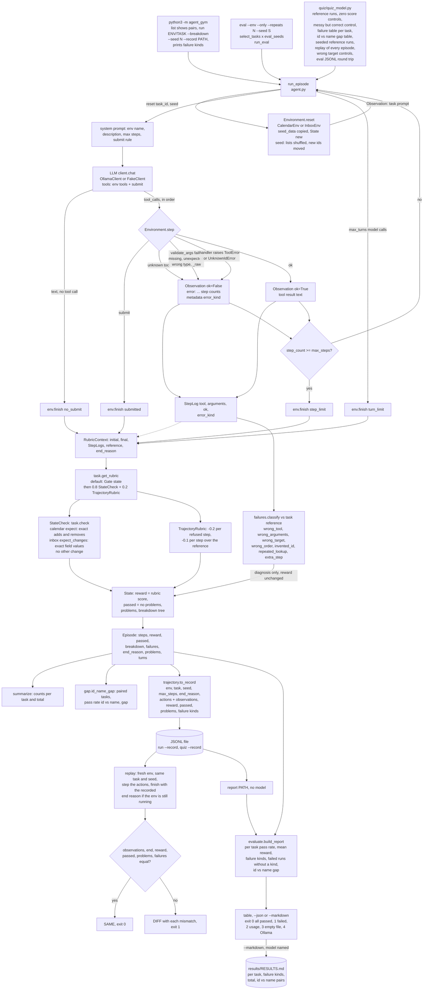

# Flow: Agent Gym

Status: **Day 7, closed**. Every box exists in the code.

## How it works

1. `run_episode` calls `env.reset(task_id)`. The environment copies its seed data (so episodes never leak into each other), starts a fresh `State` and returns the task prompt as the first `Observation`.
2. The model gets a system prompt naming the environment, its data model and its step limit, the task prompt, and the tool schemas (the env's tools plus `submit`).
3. Each tool call becomes an `Action` and goes through `env.step`. Unknown tools, bad arguments and tool errors come back as `ok=False` with an `error:` message and still count as a step (D11).
4. The episode ends on `submit`, on a plain text reply (`no_submit`), at the env's step limit or at the runner's turn limit (D10).
5. Every step, accepted or refused, is logged by the env as a `StepLog` (tool, arguments, ok, and for refused steps an `error_kind`: unknown_tool, bad_arguments, unknown_id or tool_error).
6. On every end the env builds a `RubricContext` and scores it with the task's rubric (D13). The default (D14) is a `Gate` on the state check: if the final data does not have exactly the expected changes and nothing else (D7, D9), reward is 0. Otherwise reward is 0.8 x outcome + 0.2 x trajectory, where the trajectory loses 0.2 per refused step and 0.1 per accepted step beyond the reference solution (submit not counted).
7. After scoring, `failures.classify` gives every refused or wasted step one failure kind (D18). Refused steps take theirs from the env's `error_kind` (D17). Accepted steps are compared with the task reference: an identical repeated lookup, a tool the reference does not use, more calls than the reference, or a call made before a reference prerequisite. The kinds are stored as `failures` and never change the reward (D19).
8. `passed` means the state check found no problems; `success` follows it, so a correct but messy run passes with a reward below 1.0 (D15). The full rubric tree is kept as `breakdown`. The agent never sees reward, breakdown or problems (D8).
9. `reset(task, seed=N)` shuffles the env's lists (calendars and events, agents and tickets) with `Random(N)` and, on the calendar, moves the first new event id to `evt_101` to `evt_1000` (D25). No seed means the canonical data. Ids, contents and checks are unchanged, so a reference passes on every seed, but an agent that picks "the first result" or guesses `evt_101` no longer gets lucky.
10. `trajectory.to_record` turns an `Episode` into one JSON line; `replay` rebuilds the episode from the line alone, without the model, and lists every difference (D26, D27). The quiz replays all 87 fake episodes on every run.
11. `eval` runs every chosen task once per seed (`eval_seeds`: canonical data for one repeat, otherwise seeds S, S+1, ...) and prints one line per episode, then the report (D31). `build_report` takes episodes or JSONL records, so `report runs.jsonl` gives the same table without a model (D32). Every command uses one exit code table (D33).
12. `--markdown` on `report` and `eval` prints the same report as a Markdown results table: summary with the model name, one row per task with every failure kind, a bold total, failed runs with no kind, and the id vs name pairs and gap (D34). `results/RESULTS.md` is built this way from recorded JSONL files, so the README numbers can always be rebuilt and replayed.

## Reward examples (default rubric)

| Run | passed | reward |
| --- | --- | --- |
| Reference solution, then submit | yes | 1.0 |
| One refused call, then the reference | yes | 0.8 + 0.2 x 0.8 = 0.96 |
| One refused call, one repeated lookup, then the reference | yes | 0.8 + 0.2 x 0.7 = 0.94 |
| Correct target plus collateral damage (extra deletion) | no | 0.0 (gate) |
| Submit at once | no | 0.0 (gate) |

## Failure kinds

| Kind | Step | Example |
| --- | --- | --- |
| `wrong_tool` | refused `unknown_tool`, or an accepted write tool the reference never uses | `guess_id()`, `delete_event` in `create_explicit` |
| `wrong_arguments` | refused `bad_arguments` or `tool_error` | `delete_event(id=...)`, start `3pm`, an overlapping slot |
| `invented_id` | refused `unknown_id` | `list_events(calendar_id="Personal")`, `evt_999` |
| `wrong_target` | accepted write tool the reference uses, with id arguments that match no reference call (does not use up the reference call) | `set_status(T-1003)` in `close_by_name`, `delete_event(evt_004)` in `delete_by_title` |
| `repeated_lookup` | accepted read only call identical to an earlier accepted one | `list_calendars` twice |
| `extra_step` | accepted lookup the reference never uses, or more calls of a tool than the reference | `list_calendars` in `create_explicit` |
| `wrong_order` | accepted call made before a reference prerequisite was accepted | `create_event(cal_personal, ...)` before `list_calendars` |

## Paired tasks and the id vs name gap

Some tasks come in pairs (D21): the same job and the same final state, phrased once with explicit ids (`variant="id"`) and once with names the agent must look up (`variant="name"`). `gap.id_name_gap` counts passes per variant over complete pairs and reports `gap = id pass rate - name pass rate`. In `--fake` mode the scripted reference solves both, so the gap must be 0 (D23).

| Env | Pair | id variant | name variant |
| --- | --- | --- | --- |
| calendar | `dentist` | `create_by_id` | `create_by_name` |
| calendar | `cancel_old_sync` | `delete_by_id` | `delete_by_title` |
| inbox | `assign` | `assign_by_id` | `assign_by_name` |
| inbox | `close` | `close_by_id` | `close_by_name` |
| inbox | `escalate` | `escalate_by_id` | `escalate_by_name` |

## Calendar environment

| Tool | Arguments | Refuses when |
| --- | --- | --- |
| `list_calendars` | none | never |
| `list_events` | `calendar_id`, optional `date` | unknown calendar id, bad date |
| `create_event` | `calendar_id`, `title`, `date`, `start`, `end` | unknown calendar, empty title, bad date or time, end not after start, overlap on the same calendar |
| `delete_event` | `event_id` | unknown event id |

| Task | Needs | Trap |
| --- | --- | --- |
| `create_explicit` | one create with the given id | none |
| `create_by_name` | look up "Personal" -> `cal_personal`, compute end time | guessing the id |
| `delete_by_title` | look up calendar, list events on the date, delete `evt_002` | `evt_004` has the same title a week later |
| `first_free_slot` | list events, see 14:00 is taken, book 15:00 | booking 14:00 is refused for overlap; booking later than 15:00 fails the check |
| `create_by_id` | one create on `cal_personal` (id variant of `create_by_name`) | none |
| `delete_by_id` | delete `evt_002` (id variant of `delete_by_title`) | none |

## Inbox environment

| Tool | Arguments | Refuses when |
| --- | --- | --- |
| `list_agents` | none | never |
| `search_tickets` | `query`, optional `status` | empty query, status not open or closed |
| `assign_ticket` | `ticket_id`, `agent_id` | unknown ticket or agent id |
| `set_status` | `ticket_id`, `status` | unknown ticket id, status not open or closed |
| `set_priority` | `ticket_id`, `priority` | unknown ticket id, priority not low, normal or high |

| Task | Needs | Trap |
| --- | --- | --- |
| `assign_by_id` / `assign_by_name` | T-1001 to agt_01; the name variant looks up Priya Shah and Dana Lee's ticket | T-1005 has the same subject (Kim Novak) |
| `close_by_id` / `close_by_name` | T-1002 closed; the name variant searches "login loop" and picks Bob Ortiz | T-1003 has the same subject (Ana Gomez) and must stay open |
| `escalate_by_id` / `escalate_by_name` | T-1003 high priority and assigned to agt_03 | two writes; touching the status fails the check |

`expect_changes` compares every field of every ticket with the initial data plus the expected changes, so a wrong value, a collateral change on another ticket or field, a new or removed ticket, or a changed agent list is a problem (D22). A write to the wrong ticket fails the check and is tagged `wrong_target` (D30).

