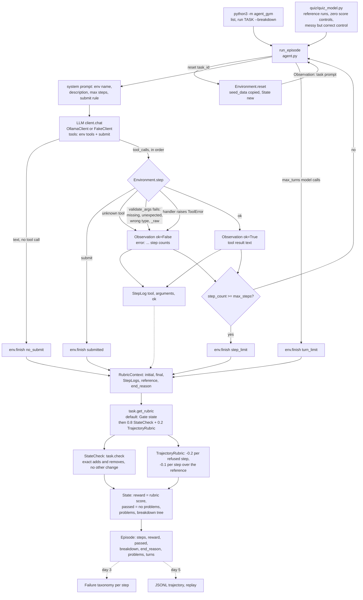

# Flow: Agent Gym

Status: **Day 2**. Every solid box exists in the code. The dashed part (failure taxonomy, trajectories) arrives on days 3 to 5.

## How it works

1. `run_episode` calls `env.reset(task_id)`. The environment copies its seed data (so episodes never leak into each other), starts a fresh `State` and returns the task prompt as the first `Observation`.
2. The model gets a system prompt naming the environment, its data model and its step limit, the task prompt, and the tool schemas (the env's tools plus `submit`).
3. Each tool call becomes an `Action` and goes through `env.step`. Unknown tools, bad arguments and tool errors come back as `ok=False` with an `error:` message and still count as a step (D11).
4. The episode ends on `submit`, on a plain text reply (`no_submit`), at the env's step limit or at the runner's turn limit (D10).
5. Every step, accepted or refused, is logged by the env as a `StepLog` (tool, arguments, ok).
6. On every end the env builds a `RubricContext` and scores it with the task's rubric (D13). The default (D14) is a `Gate` on the state check: if the final data does not have exactly the expected changes and nothing else (D7, D9), reward is 0. Otherwise reward is 0.8 x outcome + 0.2 x trajectory, where the trajectory loses 0.2 per refused step and 0.1 per accepted step beyond the reference solution (submit not counted).
7. `passed` means the state check found no problems; `success` follows it, so a correct but messy run passes with a reward below 1.0 (D15). The full rubric tree is kept as `breakdown`. The agent never sees reward, breakdown or problems (D8).

## Reward examples (default rubric)

| Run | passed | reward |
| --- | --- | --- |
| Reference solution, then submit | yes | 1.0 |
| One refused call, then the reference | yes | 0.8 + 0.2 x 0.8 = 0.96 |
| One refused call, one repeated lookup, then the reference | yes | 0.8 + 0.2 x 0.7 = 0.94 |
| Correct target plus collateral damage (extra deletion) | no | 0.0 (gate) |
| Submit at once | no | 0.0 (gate) |

## Calendar environment

| Tool | Arguments | Refuses when |
| --- | --- | --- |
| `list_calendars` | none | never |
| `list_events` | `calendar_id`, optional `date` | unknown calendar id, bad date |
| `create_event` | `calendar_id`, `title`, `date`, `start`, `end` | unknown calendar, empty title, bad date or time, end not after start, overlap on the same calendar |
| `delete_event` | `event_id` | unknown event id |

| Task | Needs | Trap |
| --- | --- | --- |
| `create_explicit` | one create with the given id | none |
| `create_by_name` | look up "Personal" -> `cal_personal`, compute end time | guessing the id |
| `delete_by_title` | look up calendar, list events on the date, delete `evt_002` | `evt_004` has the same title a week later |
| `first_free_slot` | list events, see 14:00 is taken, book 15:00 | booking 14:00 is refused for overlap; booking later than 15:00 fails the check |
