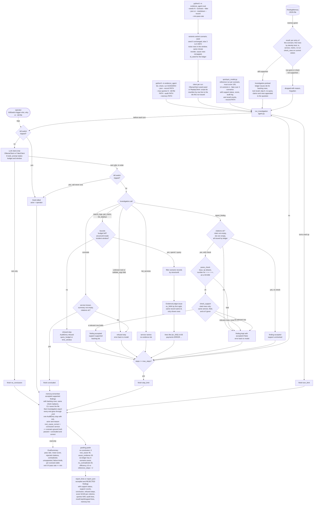

# Flow: Evidence Agent

Status: **Day 6**. Every box exists in the code.

## How it works

1. A **scenario** (`telemetry.py`) is a list of log, metric and deploy records plus a question, the true root cause service, the **cause rows** (marked with `_Cause` when the scenario is built) and the step count of its scripted reference. Three scenarios, each with a trap (D18):
   * `checkout_latency`: a payments deploy cut the db pool; red herrings are a search deploy five minutes earlier and a search cache warning.
   * `config_push`: a gateway config push cut the upstream timeout to 300 ms while api p95 is about 440 ms; red herring is a worker CPU spike to 96% two minutes before the errors.
   * `dependency_outage`: the external `email_vendor` is down; the first deploy (web, page copy) is innocent and the signup deploy comes after the failures began.
2. The **query tools** filter the records. Every row they show is given an evidence id by the **ledger** the first time it is shown (D4, D5). `list_services` and `get_metric` without a metric name only return names, so they issue no ids.
3. The model records **findings** with `report_finding(claim, evidence_ids)` and ends with `conclude(root_cause_service, summary, evidence_ids)`. Both are rejected if they cite nothing or an id the ledger never issued; the error goes back to the model (D7).
4. A finding can carry a **check** (`support.py`): service, field, op, value and an optional `at` time. If its ids are real, the check is compared with the **cited rows only**. One relevant row that holds makes it `supported`; relevant rows that all fail make it `contradicted`; no relevant row makes it `unsupported`; a malformed check is `invalid`. Anything but `supported` rejects the finding, and the error names the rows and their values so the model can fix the claim or cite better rows (D13 to D16). A finding without a check stays `unchecked` and is accepted on its citations alone.
5. The **verdict** is computed by `Investigation.report()` from the ground truth: the run passes only when it concluded with the right service (D8). The model never sees the verdict.
6. The **score** (`grading.py`, D19 to D21) grades the same run out of 100: right service (40), the conclusion cites at least one cause row, found by mapping each cited id to its record key through the ledger (30), no finding was contradicted, even one that was rejected and fixed (20), and steps within the reference plus 2, losing 2 points per extra step (10). A run without a conclusion scores 0. A run can pass and still score 70 when it names the right service but cites no row that shows the cause.
7. **Bounds** (`bounds.py`, D23 to D26). `search_logs`, `get_metric` and `list_deploys` spend one query each from a budget (default 8); once it is used up they are refused. `since`/`until` on those tools must be HH:MM inside the scenario's incident window and filter the rows; anything else is refused. Refused queries spend nothing. A **kill switch** tripped by an operator (in code, from another thread, or by creating the `--kill-file`) is checked before every model turn and every tool call; the run ends as `killed` and the pending call never runs.
8. The **audit log** has one `stop` entry per run, written by the single `_end` choke point with the rule (`concluded`, `no_conclusion`, `step_limit`, `turn_limit`, `killed`), the actor (`agent`, `system` or the operator's name) and the reason, plus a `refused` entry for every budget or window refusal. It is in the printed report, the JSON, and with `--audit PATH` in a JSONL file.
9. **Memory** (`memory.py`, D28 to D32). With a `FindingMemory` (CLI `--memory PATH`), the run first re-checks every remembered finding of this scenario: each stored row is found again by its identity (kind, time, service, metric name, not the value) and the stored check is run again on the current values with the same `check_rows` code live findings use. A missing row or a check that is no longer `supported` drops the finding with the reason, and it is forgotten. Kept findings have their backing rows issued ids before the first turn (tool `recall`, step 0, no query spent) and are shown to the model with the question, together with how many were dropped. After the run, every accepted finding whose check was supported is stored with its backing rows. Conclusions are never stored.
10. **Eval** (`variants.py`, `evaluation.py`, D33 to D37). `eval` runs each scenario on seeds 0 to N-1. Seed 0 is the scenario as written. Other seeds add 3 to 6 harmless INFO log rows inside the window, reorder rows that share a minute, and give the ledger a seeded id order, so `ev_001` stops meaning the first row shown; the incident and its cause rows stay the same. Each run gets a failure kind (`pass`, `wrong_root_cause` or the end reason), and the summary reports pass rate, mean score, rejected citations, contradicted and unsupported findings and failure kinds, as lines, `--json` or `--markdown`. With `--fake` the scripted references are replayed by `ReplayClient`, which rewrites each scripted id to the id its row got in this run by reading the tool output, the same thing a model has to do; the same scripts with memorised ids fail every variant.
