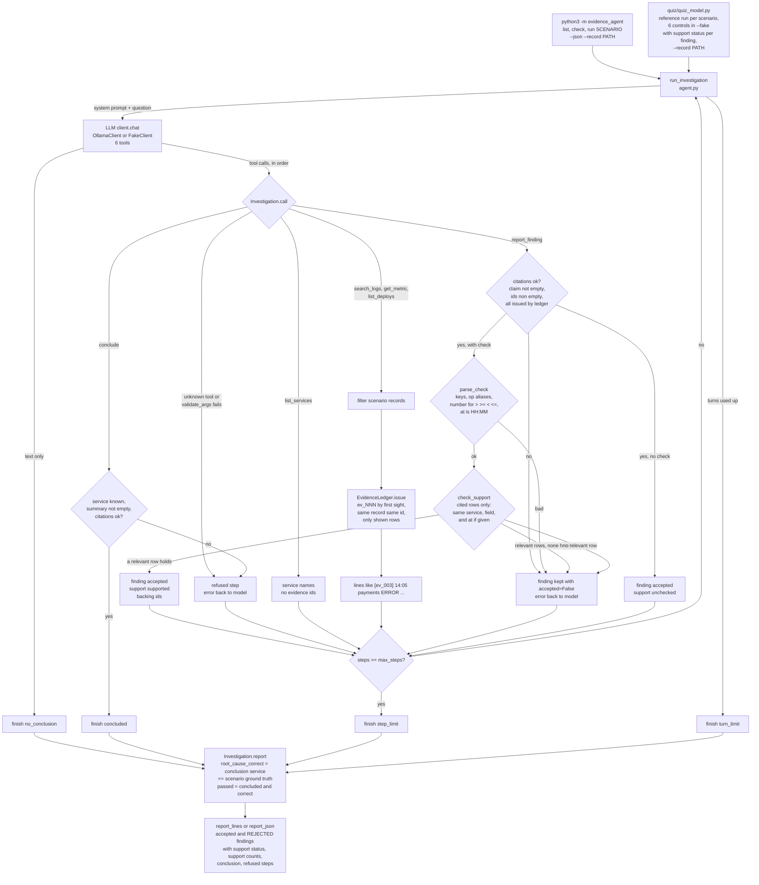

# Flow: Evidence Agent

Status: **Day 2**. Every box exists in the code.

## How it works

1. A **scenario** (`telemetry.py`) is a list of log, metric and deploy records plus a question and the true root cause service. `checkout_latency` has a payments deploy that cut the db pool, pool errors, checkout timeouts, and two red herrings: a search deploy five minutes earlier and a search cache warning.
2. The **query tools** filter the records. Every row they show is given an evidence id by the **ledger** the first time it is shown (D4, D5). `list_services` and `get_metric` without a metric name only return names, so they issue no ids.
3. The model records **findings** with `report_finding(claim, evidence_ids)` and ends with `conclude(root_cause_service, summary, evidence_ids)`. Both are rejected if they cite nothing or an id the ledger never issued; the error goes back to the model (D7).
4. A finding can carry a **check** (`support.py`): service, field, op, value and an optional `at` time. If its ids are real, the check is compared with the **cited rows only**. One relevant row that holds makes it `supported`; relevant rows that all fail make it `contradicted`; no relevant row makes it `unsupported`; a malformed check is `invalid`. Anything but `supported` rejects the finding, and the error names the rows and their values so the model can fix the claim or cite better rows (D13 to D16). A finding without a check stays `unchecked` and is accepted on its citations alone.
5. The **verdict** is computed by `Investigation.report()` from the ground truth: the run passes only when it concluded with the right service (D8). The model never sees the verdict.
